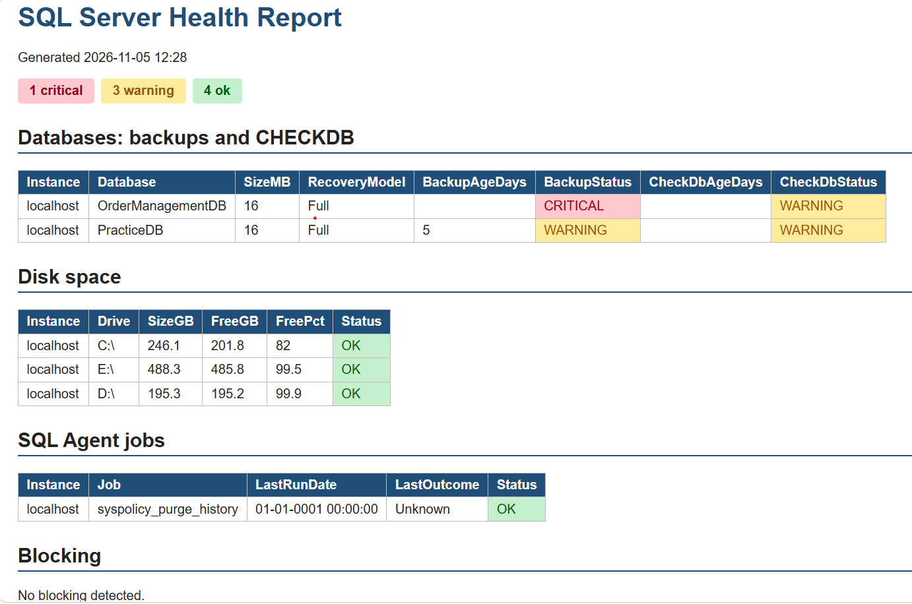

# SQL Server Health Check

PowerShell + dbatools tool that checks SQL Server instances and produces a single
colour-coded HTML report plus CSV files. Built to automate the daily checks a DBA
would otherwise do by hand.

## What it checks

| Check | What it looks at | Status rules |
|---|---|---|
| Backups | Age of the last full backup per user database | WARNING if older than 1 day, CRITICAL if none |
| CHECKDB | Age of the last good CHECKDB | WARNING if older than 7 days or never run |
| Disk space | Free space on the server's drives | WARNING under 20% free, CRITICAL under 10% |
| SQL Agent jobs | Last outcome of each enabled job | CRITICAL if the last run failed |
| Blocking | Sessions currently blocked | WARNING, or CRITICAL when waiting over 30 seconds |

An unreachable server logs a warning and does not stop the rest of the run.

## Requirements
- PowerShell 7
- dbatools (`Install-Module dbatools -Scope CurrentUser`)
- Permission to connect to the SQL Server instances

## Usage

    .\Invoke-SqlHealthCheck.ps1 -SqlInstance "SQL01","SQL02"

Reports and a run log are written to the `output` folder (ignored by Git).
Files older than 14 days are removed automatically.

## Scheduling
Run it daily with Windows Task Scheduler or a SQL Server Agent CmdExec job step
calling `pwsh.exe -NoProfile -File Invoke-SqlHealthCheck.ps1 ...`.

## Project layout

| File | Purpose |
|---|---|
| `Invoke-SqlHealthCheck.ps1` | Runner: collects checks, writes reports, logs the run |
| `Get-SqlHealthReport.ps1` | Backup and CHECKDB age |
| `Get-SqlDiskReport.ps1` | Disk space |
| `Get-SqlJobReport.ps1` | Failed Agent jobs |
| `Get-SqlBlockingReport.ps1` | Current blocking |
| `New-SqlHealthHtml.ps1` | Builds the combined HTML report |

## Notes
- Built and tested on a local SQL Server Developer Edition instance.
- `-TrustServerCertificate` is for local practice instances only. Use a trusted
  certificate on real servers.
